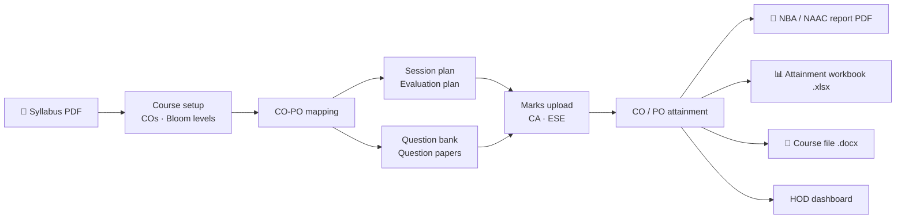

<a href="https://obe-automate.vercel.app"></a>

<h3 align="center"><i>Weeks of accreditation paperwork, generated from one syllabus.</i></h3>

<p align="center">
  <a href="https://obe-automate.vercel.app"></a>
  
  
  
  <a href="LICENSE"></a>
</p>

<p align="center">
  <a href="https://obe-automate.vercel.app"><b>Try it live ↗</b></a> &nbsp;•&nbsp;
  <a href="#the-problem">The problem</a> &nbsp;•&nbsp;
  <a href="#what-it-does">What it does</a> &nbsp;•&nbsp;
  <a href="#architecture">Architecture</a> &nbsp;•&nbsp;
  <a href="#getting-started">Getting started</a>
</p>

### Timeline

> **June 2026** — **Faculty feedback round:** more reliable syllabus extraction and a series of backend updates driven by real course data.
>
> **May 2026** — The **CO-PO attainment workbook** in the institute's Excel template, and the complete 13-section **OBE course file** as Word.
>
> **April 2026** — **Marks & attainment:** manual entry and Excel upload, attainment with gap analysis, plus the question generator,
> question bank, HOD dashboard, JWT auth and Docker deployment.

---

## The problem

Engineering colleges applying for NBA or NAAC accreditation must show, course by course, that students
actually reached the intended outcomes. That means mapping every Course Outcome (CO) to Program
Outcomes (POs), planning every lecture and assessment against those COs, tagging every exam question
with a CO and a Bloom's level, and finally computing attainment from real marks. It's done in
spreadsheets and Word templates, by hand, every semester.

## What it does



| | |
|---|---|
| **Syllabus extraction** | Reads a syllabus PDF — text via PyMuPDF, scanned or screenshot pages via a vision model — and extracts units, topics and course outcomes. |
| **Bloom's classification** | Tags each CO and question with a Bloom's taxonomy level using the LLM, with an instant rule-based fallback when it's unavailable. |
| **CO-PO mapping engine** | Explainable by design: each PO has an evidence "gate" the CO statement must meet before any correlation is assigned, so mappings can be justified line by line to an auditor. |
| **Session & evaluation plans** | Generates lecture-by-lecture session plans and CA/ESE evaluation plans in the institute's Word format, editable in a table — including by plain-English instructions ("add a Program Indicator column"). |
| **Question bank & papers** | Generates and classifies questions by CO, PO, Bloom level and marks, and assembles question papers. |
| **Marks & attainment** | Bulk marks upload from Excel; CO attainment = share of students above the threshold, rolled up into PO attainment through the CO-PO matrix. |
| **Reports** | NBA/NAAC-format PDF with attainment tables, gap analysis, charts, CO-PO correlation matrix and improvement recommendations; a pre-filled CO-PO attainment workbook; and the complete 13-section OBE course file. |
| **Study materials** | Suggests textbooks, NPTEL courses, journals and MOOCs mapped to the course outcomes. |
| **HOD dashboard** | Department-wide CO/PO attainment heatmap across every course with marks. |
| **Roles** | Faculty, HOD and admin accounts with JWT auth and login rate limiting. |

## Architecture

```
┌──────────────────────────┐        ┌──────────────────────────────────────────┐
│ React SPA                │  JSON  │ FastAPI                                  │
│ index.html + app.js      ├───────►│ routes/   auth · courses · syllabus ·    │
│ (in-browser JSX, no      │        │           session/evaluation plans ·     │
│  build step)             │        │           questions · attainment · ai    │
└──────────────────────────┘        │ services/ CO-PO engine · report builders │
                                    │ core/     LLM fallback chain · storage   │
                                    └───────┬───────────────────┬──────────────┘
                                            │                   │
                              ┌─────────────▼──────┐   ┌────────▼─────────────────┐
                              │ SQLite (dev)       │   │ Gemini → Groq → OpenAI   │
                              │ PostgreSQL (prod)  │   │ first available wins     │
                              └────────────────────┘   └──────────────────────────┘
```

- **LLM fallback chain** — every AI feature goes through one helper that tries Gemini, then Groq, then
  OpenAI, so a single provider outage or quota limit doesn't take features down.
- **Documents** — Word via `python-docx`, PDF via ReportLab, Excel via `openpyxl`, all generated server-side.
- **Storage** — generated files go to `generated_docs/` locally, or to a mounted volume in production (`STORAGE_PATH`).

## Getting started

```bash
git clone https://github.com/Xenomorph27/obe-automate.git
cd obe-automate
python -m venv .venv && source .venv/bin/activate    # Windows: .venv\Scripts\activate
pip install -r requirements.txt
cp .env.example .env                                 # add at least one LLM key
ENVIRONMENT=dev uvicorn backend.main:app --reload    # http://localhost:8000
```

SQLite is used by default, so there is nothing else to set up. With `ENVIRONMENT=dev` the API docs are
served at `/docs`.

On first start the app creates `faculty`, `hod` and `admin` accounts. **Set `FACULTY_PASSWORD`,
`HOD_PASSWORD` and `ADMIN_PASSWORD` before the first start of any shared or deployed instance.**

### Configuration

| Variable | |
|---|---|
| `GEMINI_API_KEY`, `GROQ_API_KEY`, `OPENAI_API_KEY` | LLM providers, tried in that order — at least one required |
| `DATABASE_URL` | `sqlite:///./obe_automate.db` by default; a PostgreSQL URL in production |
| `FACULTY_PASSWORD`, `HOD_PASSWORD`, `ADMIN_PASSWORD` | Passwords for the accounts created on first start |
| `STORAGE_PATH` | Persistent folder for generated documents (e.g. a mounted volume) |
| `ENVIRONMENT` | `dev` exposes `/docs`; anything else hides the API docs |

### Docker

```bash
docker build -t obe-automate .
docker run -p 8000:8000 --env-file .env obe-automate
```

`railway.json` deploys the same image on Railway with a `/health` check.

## Project structure

```
backend/
├── main.py           # app, CORS, login rate limiter, static files
├── routes/           # HTTP endpoints, one module per area
├── services/         # CO-PO engine, attainment, plan/report/course-file builders
├── database/         # async SQLAlchemy models and connection
└── core/             # auth, config, LLM chain, storage, logging
frontend/
├── index.html        # styles + CDN React
└── app.js            # the single-page app
```

## License

[MIT](LICENSE) © Barnak Roy Nandy
